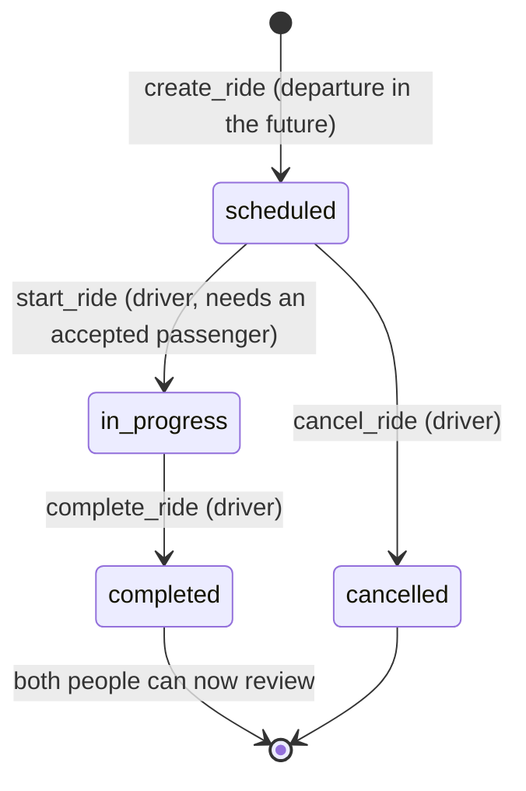

# Architecture

Wnesny is a modular Flask application built with the application factory pattern. This page explains the modules and the
design decisions behind them. The diagram is in [diagrams/architecture.md](diagrams/architecture.md).

## Modules

| Module | Responsibility |
|--------|----------------|
| `app/__init__.py` | `create_app()` application factory. Picks the configuration, fails fast on an unknown environment name or a production start without `SECRET_KEY` / `DATABASE_URL`, and wires the extensions. |
| `config.py` | `DevelopmentConfig` (SQLite in `instance/`), `TestingConfig` (in-memory SQLite) and `ProductionConfig`. Values come from environment variables or a local `.env` file. |
| `app/extensions.py` | The shared `SQLAlchemy` and `Migrate` objects. Turns on `PRAGMA foreign_keys=ON` for every SQLite connection so foreign keys are really enforced. |
| `app/models/` | One file per table (10 tables): columns, `CHECK` constraints, indexes, relationships. |
| `app/services/database_service.py` | The business rules that need more than one table (see below). Routes must call this layer and never change rows directly. |
| `migrations/` | Alembic environment and the initial migration. The schema is changed only through migrations, never with `db.create_all()` on a real database. |
| `seed_interests.py` | Idempotent seed of the interest catalogue. |

Planned, not built yet: HTTP routes (blueprints), authentication with sessions and CSRF protection, the matching engine and the dashboard.

## Rules and where they are enforced

| Rule from the project idea | Database | Service layer |
|----------------------------|----------|---------------|
| One account can drive one trip and ride in another (no separate account types) | one `users` table | no role checks |
| A ride has one driver and at most one accepted passenger | partial unique index `uq_accepted_request_per_ride` | `accept_ride_request` refuses a second one; a database conflict is turned into a clear error |
| Only the driver answers requests and changes the ride status | none | `accept_ride_request`, `reject_ride_request`, `start_ride`, `complete_ride` and `cancel_ride` all take the driver's id and check it |
| A passenger cannot join their own ride or ask twice; an accepted passenger may cancel while the ride is scheduled, which reopens the ride | `UNIQUE (ride_id, passenger_id)` | `submit_ride_request`, `cancel_ride_request` |
| A chat exists only after acceptance, and only the two people can write | one conversation per request (`UNIQUE`) | `accept_ride_request` creates it, `send_message` checks the sender |
| Reviews only after completion, between the two participants, once | rating 1 to 5, no self-review, `UNIQUE (ride_id, reviewer_id, reviewed_user_id)` | `create_review` |
| History is never lost | `RESTRICT` on driver, passenger, sender and reviewer keys | `cancel_ride` closes requests and chats instead of deleting them |
| Privacy: coarse addresses only, no live GPS, optional education with a visibility setting | `education_visibility` check, optional coordinates | coordinates must come in pairs and inside valid ranges |

## Ride lifecycle

A request goes `pending` to `accepted`, `rejected` or `cancelled`; an accepted request can still be cancelled by its passenger while the ride is scheduled. When a ride is cancelled, its pending requests are
cancelled and those passengers are notified, and the chat of an accepted request is frozen.

## Design decisions

- **Service layer, not logic in models or routes.** Rules such as "accept one request and reject the others" must run in one
  transaction. Keeping them in one module makes them testable without HTTP.
- **Constraints in the database as the last line of defence.** The service layer gives friendly errors; the database stops
  anything that slips through, for example two drivers accepting at the same moment.
- **SQLite for development, PostgreSQL-compatible schema.** The partial unique index and `CHECK` constraints work on both.
