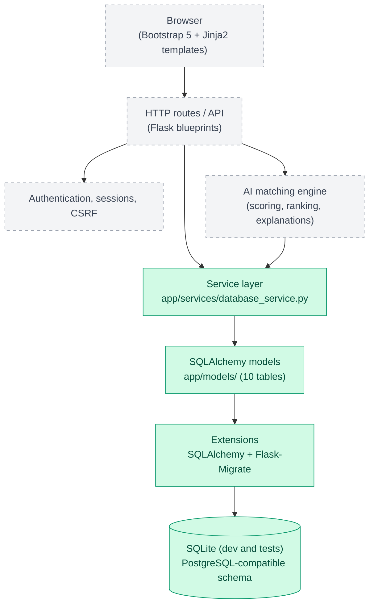

# Architecture Diagram

Wnesny is a modular Flask application built with the application factory pattern. Business rules live in a service layer, separate from the models. HTTP routes will call this layer once they are built.

Legend: solid boxes are implemented, dashed boxes are planned.

## Layer responsibilities

| Layer | Responsibility | Status |
|-------|----------------|--------|
| Browser / templates | User-facing pages | Planned |
| HTTP routes | Parse requests, call services, render responses | Planned |
| Authentication | Login, sessions, CSRF protection | Planned |
| AI matching engine | Compatibility scoring, ranking, explanations | Planned |
| Service layer | Transactional business rules (requests, acceptance, cancellation, chat, reviews, notifications) | Implemented |
| Models | Tables, constraints, indexes, relationships | Implemented |
| Extensions and migrations | Database session, Alembic migrations | Implemented |

See [architecture.md](../architecture.md) for module responsibilities and design decisions.
