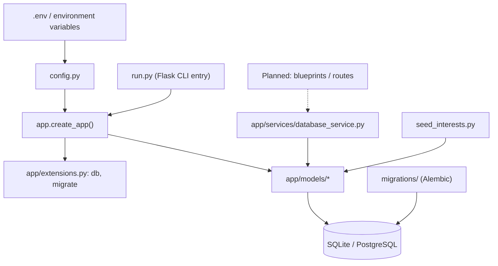
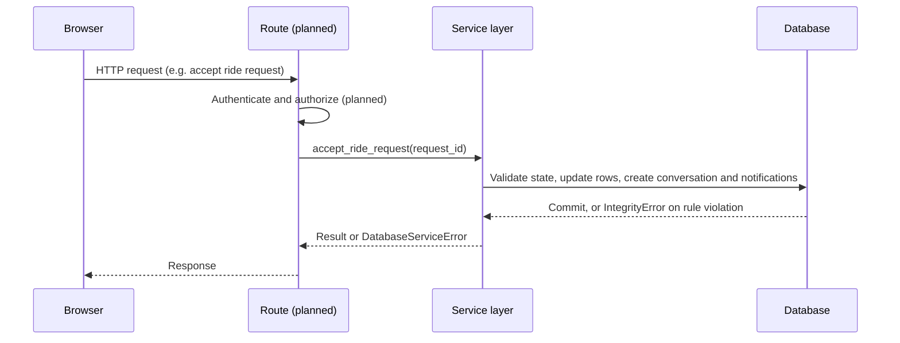

# Wnesny Architecture

This document describes the architecture **as currently implemented** (database foundation) and marks planned components explicitly.

## 1. Overview

Wnesny is a Flask application built with the **application factory** pattern. Responsibilities are split into layers:

| Layer | Location | Responsibility | Status |
|---|---|---|---|
| Configuration | `config.py`, `.env` | Environment-specific settings (development, testing, production) | Implemented |
| Application factory | `app/__init__.py` | Builds the Flask app, loads config, validates production settings, initializes extensions | Implemented |
| Extensions | `app/extensions.py` | Shared `db` (Flask-SQLAlchemy) and `migrate` (Flask-Migrate) instances; enables SQLite foreign keys on every connection | Implemented |
| Models | `app/models/` | Table structure, relationships, database-level constraints, light constructor validation | Implemented |
| Services | `app/services/database_service.py` | Business rules that span several tables, executed in transactions | Implemented |
| Migrations | `migrations/` | Versioned schema changes (Alembic) | Implemented |
| Seed data | `seed_interests.py` | Idempotent interest catalogue | Implemented |
| Routes / API (blueprints) | — | HTTP handling, authentication, authorization | Planned |
| Templates / static | — | Jinja2 + Bootstrap UI | Planned |
| Matching engine | — | Compatibility scoring and ranking | Planned |

## 2. Component diagram

## 3. Request flow (planned)

Routes are not implemented yet. The intended flow, which the service layer is designed for:

## 4. Key design decisions

1. **One account, two roles.** Driver and passenger are roles a user plays per ride (`rides.driver_id`, `ride_requests.passenger_id`). There are no separate driver or rider tables.
2. **Single accepted passenger.** Enforced twice: by the partial unique index `uq_accepted_request_per_ride` (database) and by `accept_ride_request()` (service), which also rejects competing pending requests in the same transaction.
3. **One request per passenger per ride**, even after rejection or cancellation (`UNIQUE (ride_id, passenger_id)`). This policy can be relaxed later by a migration.
4. **History preservation.** Driver, passenger, sender and reviewer foreign keys use `ON DELETE RESTRICT`, and the ORM relationships do not cascade deletes, so deleting a user with ride history fails instead of silently removing records. Users are deactivated with `is_active`. Cancelled rides keep their accepted request and conversation (the conversation is set inactive).
5. **Schema ownership.** Only Alembic migrations create or alter tables on real databases. `db.create_all()` is used only inside the test fixtures for speed; the migrations themselves are tested separately (`tests/test_migrations.py`).
6. **Portability.** The schema avoids SQLite-only features. The partial index is declared for both SQLite and PostgreSQL. `postgres://` URLs are normalized to `postgresql://`.
7. **UTC timestamps.** All timestamps are timezone-aware and default to `datetime.now(timezone.utc)`.

## 5. Service-layer functions

| Function | Rule(s) enforced |
|---|---|
| `create_user` | Normalized unique email, hashed password |
| `create_user_profile` | User exists, one profile per user, valid visibility |
| `assign_interests_to_user` | All interest IDs exist; duplicates collapsed |
| `create_ride` | Active driver, coordinate ranges |
| `submit_ride_request` | Active passenger, not own ride, ride `scheduled`, no accepted passenger yet, no duplicate; notifies driver |
| `accept_ride_request` | Pending request on a scheduled ride; rejects competitors; creates conversation; notifications |
| `reject_ride_request` / `cancel_ride_request` | Only pending requests; cancel only by the owner |
| `cancel_ride` | Only by the driver; deactivates conversation; notifies accepted passenger; cancels pending requests |
| `create_conversation_for_accepted_request` | Request must be accepted; idempotent |
| `send_message` | Active conversation; sender is driver or accepted passenger; non-empty; notifies recipient |
| `create_review` | Ride completed; both users are participants; no self or duplicate review |
| `create_notification` | Persists a notification |

Violations raise `DatabaseServiceError`.

## 6. Known limitations

- No HTTP layer, authentication, or authorization checks at the request level yet. Authorization is currently expressed only as service-level participant checks.
- Concurrency: the partial unique index guarantees correctness under concurrent acceptance (a second commit fails with `IntegrityError`). The service does not yet translate that error into a friendly `DatabaseServiceError`.
- No matching engine yet.

