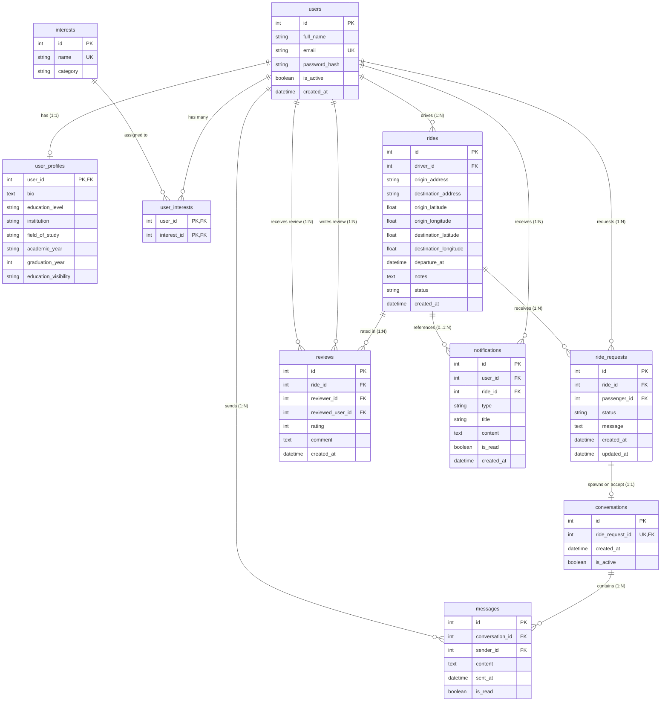

# Wnesny Database Architecture & Schema Specification (V1.0)

## 1. Overview & System Purpose

**Wnesny** is an AI-powered, interest-based ride-sharing web platform. Unlike traditional ride-hailing applications that match drivers and riders purely by proximity and route distance, Wnesny matches participants by combining geographical route compatibility with social compatibility (shared interests, educational background where voluntarily shared, and conversation preferences).

A central architectural principle of Wnesny is role flexibility:
> **One registered user account can publish rides as a driver in one trip and request to join rides as a passenger in another trip.** The system does not create segregated user tiers or irreversible role assignments.

Furthermore:
> **A ride can have exactly ONE driver and at most ONE accepted passenger.**

This document provides the complete database design, schema dictionary, relationship architecture, constraint rationale, and migration instructions.

---

## 2. Entity-Relationship Diagram (Mermaid ERD)



---

## 3. Data Dictionary & Table Specifications

### 3.1 `users` Table
Stores registered accounts for both drivers and passengers.

| Column | Type | Nullable | Default | Constraints & Description |
|---|---|---|---|---|
| `id` | Integer | No | Auto | **Primary Key**. Unique user identifier. |
| `full_name` | String(100) | No | None | User's full name. |
| `email` | String(150) | No | None | **Unique, Indexed**. Normalized email address (lowercased, trimmed). |
| `password_hash` | String(255) | No | None | PBKDF2/scrypt hashed password via Werkzeug. Plaintext passwords never stored. |
| `is_active` | Boolean | No | `True` | Account state flag for soft deactivation. |
| `created_at` | DateTime(tz) | No | `UTC now` | Account registration timestamp. |

* **Delete Strategy**: Restrict deletion to preserve historical ride, audit, and rating data.

---

### 3.2 `user_profiles` Table
Stores extended optional profile data and privacy controls.

| Column | Type | Nullable | Default | Constraints & Description |
|---|---|---|---|---|
| `user_id` | Integer | No | None | **Primary Key & Foreign Key** (`users.id`, `ON DELETE CASCADE`). 1:1 relationship. |
| `bio` | Text | Yes | None | Optional user self-description and hobbies. |
| `education_level` | String(50) | Yes | None | Optional degree level (e.g., Undergraduate, Master's). |
| `institution` | String(150) | Yes | None | Optional university or institution name. |
| `field_of_study` | String(100) | Yes | None | Optional major or specialization. |
| `academic_year` | String(30) | Yes | None | Optional current academic year. |
| `graduation_year` | Integer | Yes | None | Optional anticipated graduation year. |
| `education_visibility` | String(20) | No | `'matches_only'` | **CHECK**: `('public', 'matches_only', 'private')`. Privacy control for AI matching and display. |

---

### 3.3 `interests` Table
Predefined catalogue of interest tags across categories for explainable social matching.

| Column | Type | Nullable | Default | Constraints & Description |
|---|---|---|---|---|
| `id` | Integer | No | Auto | **Primary Key**. |
| `name` | String(100) | No | None | **Unique, Indexed**. Name of interest (e.g., 'Artificial Intelligence', 'Football'). |
| `category` | String(100) | No | None | **Indexed**. Grouping category (e.g., 'Technology', 'Sports', 'Music'). |

---

### 3.4 `user_interests` Table
Association table representing the Many-to-Many relationship between users and interests.

| Column | Type | Nullable | Constraints & Description |
|---|---|---|---|
| `user_id` | Integer | No | **Composite PK & FK** (`users.id`, `ON DELETE CASCADE`). |
| `interest_id` | Integer | No | **Composite PK & FK** (`interests.id`, `ON DELETE CASCADE`). |

* **Constraint**: The composite primary key `(user_id, interest_id)` guarantees no duplicate interest assignments per user.

---

### 3.5 `rides` Table
Stores rides published by drivers.

| Column | Type | Nullable | Default | Constraints & Description |
|---|---|---|---|---|
| `id` | Integer | No | Auto | **Primary Key**. |
| `driver_id` | Integer | No | None | **Foreign Key** (`users.id`, `ON DELETE RESTRICT`), **Indexed**. |
| `origin_address` | String(200) | No | None | Origin street/area text. |
| `destination_address` | String(200) | No | None | Destination street/area text. |
| `origin_latitude` | Float | Yes | None | **CHECK**: `-90.0 <= origin_latitude <= 90.0`. |
| `origin_longitude` | Float | Yes | None | **CHECK**: `-180.0 <= origin_longitude <= 180.0`. |
| `destination_latitude` | Float | Yes | None | **CHECK**: `-90.0 <= destination_latitude <= 90.0`. |
| `destination_longitude` | Float | Yes | None | **CHECK**: `-180.0 <= destination_longitude <= 180.0`. |
| `departure_at` | DateTime(tz) | No | None | **Indexed**. Planned departure time. |
| `notes` | Text | Yes | None | Driver instructions (luggage, music, AC, quiet car, etc.). |
| `status` | String(20) | No | `'scheduled'` | **CHECK**: `('scheduled', 'in_progress', 'completed', 'cancelled')`, **Indexed**. |
| `created_at` | DateTime(tz) | No | `UTC now` | Publication timestamp. |

---

### 3.6 `ride_requests` Table
Stores passenger applications to join scheduled rides.

| Column | Type | Nullable | Default | Constraints & Description |
|---|---|---|---|---|
| `id` | Integer | No | Auto | **Primary Key**. |
| `ride_id` | Integer | No | None | **Foreign Key** (`rides.id`, `ON DELETE CASCADE`), **Indexed**. |
| `passenger_id` | Integer | No | None | **Foreign Key** (`users.id`, `ON DELETE RESTRICT`), **Indexed**. |
| `status` | String(20) | No | `'pending'` | **CHECK**: `('pending', 'accepted', 'rejected', 'cancelled')`, **Indexed**. |
| `message` | Text | Yes | None | Optional introductory note from passenger. |
| `created_at` | DateTime(tz) | No | `UTC now` | Submission timestamp. |
| `updated_at` | DateTime(tz) | No | `UTC now` | Last status modification timestamp. |

#### Critical Constraints:
1. `UniqueConstraint("ride_id", "passenger_id", name="uq_ride_passenger")`:
   Guarantees that a passenger cannot submit duplicate requests for the same ride.
2. **Partial Unique Index** `uq_accepted_request_per_ride`:
   ```sql
   CREATE UNIQUE INDEX uq_accepted_request_per_ride ON ride_requests (ride_id) WHERE status = 'accepted';
   ```
   **How it works**: In both SQLite (3.8.0+) and PostgreSQL, this partial index guarantees at the database storage engine level that **only ONE row with `status = 'accepted'` can exist per `ride_id`**.

---

### 3.7 `conversations` Table
Private chat sessions unlocked exclusively when a ride request is accepted.

| Column | Type | Nullable | Default | Constraints & Description |
|---|---|---|---|---|
| `id` | Integer | No | Auto | **Primary Key**. |
| `ride_request_id` | Integer | No | None | **Unique, Foreign Key** (`ride_requests.id`, `ON DELETE CASCADE`). Exactly 1 conversation per accepted request. |
| `created_at` | DateTime(tz) | No | `UTC now` | Creation timestamp. |
| `is_active` | Boolean | No | `True` | Set to `False` when a ride is completed or cancelled to freeze messaging. |

---

### 3.8 `messages` Table
Individual chat messages exchanged between driver and accepted passenger.

| Column | Type | Nullable | Default | Constraints & Description |
|---|---|---|---|---|
| `id` | Integer | No | Auto | **Primary Key**. |
| `conversation_id` | Integer | No | None | **Foreign Key** (`conversations.id`, `ON DELETE CASCADE`), **Indexed**. |
| `sender_id` | Integer | No | None | **Foreign Key** (`users.id`, `ON DELETE RESTRICT`), **Indexed**. |
| `content` | Text | No | None | Message text. **CHECK**: `length(trim(content)) > 0`. |
| `sent_at` | DateTime(tz) | No | `UTC now` | Message sent timestamp, **Indexed**. |
| `is_read` | Boolean | No | `False` | Read receipt flag. |

---

### 3.9 `reviews` Table
Mutual reviews and ratings submitted after a ride reaches `completed` status.

| Column | Type | Nullable | Default | Constraints & Description |
|---|---|---|---|---|
| `id` | Integer | No | Auto | **Primary Key**. |
| `ride_id` | Integer | No | None | **Foreign Key** (`rides.id`, `ON DELETE CASCADE`), **Indexed**. |
| `reviewer_id` | Integer | No | None | **Foreign Key** (`users.id`, `ON DELETE RESTRICT`), **Indexed**. |
| `reviewed_user_id` | Integer | No | None | **Foreign Key** (`users.id`, `ON DELETE RESTRICT`), **Indexed**. |
| `rating` | Integer | No | None | **CHECK**: `1 <= rating <= 5`. Rating scale. |
| `comment` | Text | Yes | None | Optional written review. |
| `created_at` | DateTime(tz) | No | `UTC now` | Timestamp when review was submitted. |

#### Constraints:
1. `chk_no_self_review`: `CHECK (reviewer_id != reviewed_user_id)` prevents reviewing oneself.
2. `uq_ride_reviewer_reviewed`: `UNIQUE (ride_id, reviewer_id, reviewed_user_id)` ensures exactly one review per participant pair per ride.
3. Service-level checks verify that `ride.status == 'completed'` and both parties were actual ride participants.

---

### 3.10 `notifications` Table
In-app persistent notification log for asynchronous user updates.

| Column | Type | Nullable | Default | Constraints & Description |
|---|---|---|---|---|
| `id` | Integer | No | Auto | **Primary Key**. |
| `user_id` | Integer | No | None | **Foreign Key** (`users.id`, `ON DELETE CASCADE`), **Indexed**. Recipient. |
| `ride_id` | Integer | Yes | None | **Foreign Key** (`rides.id`, `ON DELETE SET NULL`), **Indexed**. Associated ride if applicable. |
| `type` | String(50) | No | None | Event type (`new_request`, `request_accepted`, `request_rejected`, `ride_cancelled`, `new_message`). |
| `title` | String(150) | No | None | Brief subject line. |
| `content` | Text | No | None | Detailed message body. |
| `is_read` | Boolean | No | `False` | Status indicator for unread notification count. |
| `created_at` | DateTime(tz) | No | `UTC now` | Timestamp, **Indexed**. |

---

## 4. Architectural Rules & Invariants

1. **Role Agility**: Any user in `users` can publish a ride (`Ride.driver_id = user.id`) or request a ride (`RideRequest.passenger_id = user.id`).
2. **Single Accepted Passenger**:
   - Partial Unique Index `uq_accepted_request_per_ride` rejects any SQL `INSERT` or `UPDATE` setting `status = 'accepted'` if another row for that `ride_id` is already accepted.
   - `database_service.accept_ride_request(request_id)` runs in a database transaction that:
     1. Verifies the ride is `scheduled`.
     2. Sets the selected request to `accepted`.
     3. Automatically transitions competing pending requests for that ride to `rejected`.
     4. Instantiates the private `Conversation`.
     5. Emits `Notification` records.
3. **Cancellation & History Preservation**:
   - When a ride is cancelled by its driver via `cancel_ride`:
     1. `ride.status` transitions to `'cancelled'`.
     2. The accepted `RideRequest` record is preserved for auditing and dispute tracking.
     3. Associated `Conversation.is_active` is toggled to `False`, permanently disabling new message submissions.
     4. A persistent notification is generated for the accepted passenger.
     5. Any lingering pending requests are marked `'cancelled'`.
4. **Safety & Security**:
   - Plaintext passwords never enter the database; only cryptographic hashes are stored.
   - Foreign key integrity is strictly enforced in SQLite via `PRAGMA foreign_keys = ON;`.
   - Ratings are bounded between 1 and 5.
   - Cross-user message sending and fake participant reviews are blocked by service-layer participant validation.

---

## 5. Developer Guide & Operations

### 5.1 Initialize & Migrate the Database
```bash
# 1. Upgrade schema to the latest migration
flask --app run.py db upgrade

# 2. Seed default interest catalog (idempotent, safe to repeat)
python seed_interests.py
```

### 5.2 Running the Test Suite
```bash
# Run all tests with verbose output
pytest -v

# Run only database models and constraint suites
pytest tests/test_models.py tests/test_relationships.py tests/test_constraints.py tests/test_database_service.py -v
```

### 5.3 Inspecting the SQLite Database
You can inspect the database directly using Python or the SQLite CLI:
```bash
python -c "import sqlite3; conn = sqlite3.connect('instance/wnesny_dev.db'); print([r[0] for r in conn.execute('SELECT name FROM sqlite_master WHERE type=\'table\'').fetchall()])"
```
Or with the `sqlite3` CLI tool:
```bash
sqlite3 instance/wnesny_dev.db
.tables
.schema rides
.schema ride_requests
SELECT * FROM interests LIMIT 5;
.quit
```
