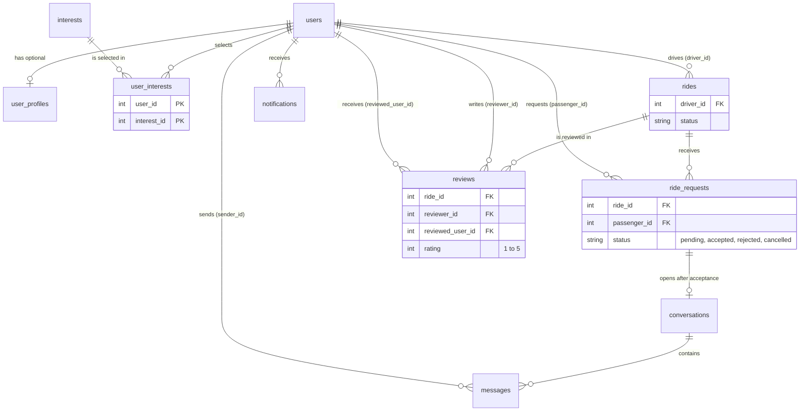

# Database Relationships

The schema has 10 tables, normalized to 3NF. This diagram shows the relationships and the key columns involved. The full data dictionary is in [database-schema.md](../database-schema.md).

## Key constraints

- `UNIQUE (ride_id, passenger_id)`: one request per passenger per ride.
- Partial unique index `uq_accepted_request_per_ride ON ride_requests(ride_id) WHERE status = 'accepted'`: at most one accepted passenger per ride.
- `UNIQUE (ride_id, reviewer_id, reviewed_user_id)`: no duplicate reviews.
- `user_interests` uses a composite primary key.
- RESTRICT on driver, passenger, sender and reviewer foreign keys, so history cannot be deleted by accident.

## Rules enforced in the service layer

These rules need context across several tables:

- Only the driver of a ride accepts or rejects its requests, starts, completes or cancels it.
- No requesting your own ride.
- Requests only on scheduled rides; rides can be cancelled only while scheduled.
- A passenger can cancel a pending or an accepted request (accepted only while the ride is scheduled); this reopens the ride.
- Conversations only for accepted requests.
- Messages only from the two participants, in active conversations.
- Reviews only after completion and only between participants.
