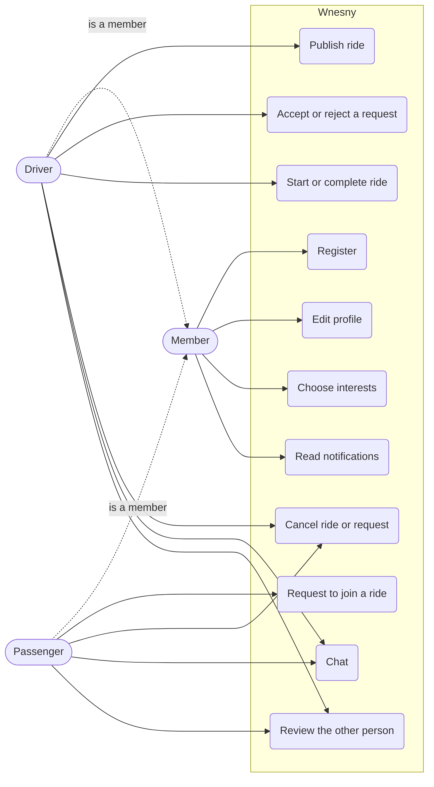

# Use-case diagram

Use cases of the Wnesny service layer (`app/services/database_service.py`). The web pages that will call them are planned for M4.

Rules: only the driver accepts, rejects, starts, completes or cancels a ride; chat and reviews exist only for the accepted
passenger and the driver. See the table in [../architecture.md](../architecture.md).
