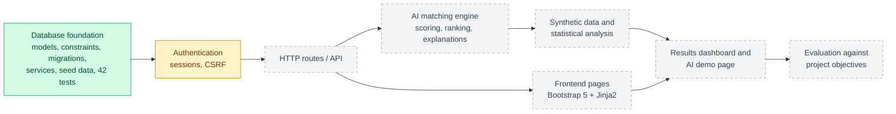

# Development Roadmap

This roadmap reflects the current state of the project: the database foundation is complete, and everything else is planned.

## Status

| Phase | Scope | Status |
|-------|-------|--------|
| 1. Database foundation | Models, constraints, migrations, service layer, interest seed, tests | Done |
| 2. Authentication | Login, sessions, CSRF protection | Not started |
| 3. HTTP routes / API | Routes that call the service layer | Not started |
| 4. Frontend | At least 4 pages (Bootstrap 5 + Jinja2) | Not started |
| 5. AI matching engine | Compatibility scoring, ranking, explanations | Not started |
| 6. Data and statistics | Synthetic data generation, analysis | Not started |
| 7. Dashboard and demo | Results dashboard, AI demo page | Not started |
| 8. Evaluation | Check results against the M1 objectives | Not started |
